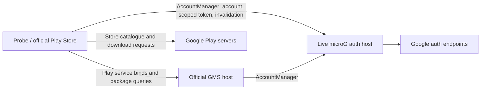

# Live microG authentication and official Play API validation

**Follow-up: official SDK token issuance and Spotify Google login failed.**
The [official-auth validation](google-official-auth-validation.md) confirms
`BadAuthentication` from official GMS while the direct microG control succeeds,
plus a separate unsuccessful Spotify Google login. The bounded results below
remain valid; they do not establish general official GMS authentication.

**Passed a bounded board validation on 2026-11-15 Pacific / 2026-11-16 UTC.**
One client obtained scoped tokens from a live microG host and a nonzero Advertising
ID from a separate official GMS host. Official Play Store used the same auth
proxy, loaded its catalogue and search page, and downloaded and installed
WhatsApp. Both providers passed independent outage/restart checks. Wrong account,
ungranted scope, package override and ungranted signer requests were denied;
revoking a live client's grant removed its cached account record.

This extends the [sequential credential handoff](google-bootstrap-board-results.md).
The new design does **not** import the reusable credential into official GMS or
Play Store. It is an opt-in experiment, not a production security boundary or a
Google approval mechanism. Official GMS still reported `uncertified_status=1`.

The [machine-readable result](../tests/google-bootstrap/two-path-validation.json)
links the preserved evidence. Earlier failed builds remain in that record and
in `tests/google-bootstrap/two-path-results/`; final results use framework build
04. Board operations below used actual APKs and runtime services, not mocks.

## What ran



microG and official GMS both use the package name `com.google.android.gms` inside
separate launch/package/data namespaces. The auth socket is independent of the
normal Play service socket; microG is not substituted for ordinary Play APIs.

| Component | Tested version / identity |
| --- | --- |
| Board | OpenHarmony 6.1.0.31, aarch64, kernel 5.15.180 |
| Android profile | HopeRun / DAYU200 / Android 14 / SDK 34 |
| microG | 0.3.17.252432; APK SHA-256 `e5e6cba078bdec812b5450599350e5c1a12c8b7438da5bf77123af170f8c1a35` |
| Official GMS | 244034029; base APK SHA-256 `1159bb46cad6f4afd7f4a570b1a5674f1285a12e573dbe6501ed4b059fd902d1` |
| Official Play Store | 53.5.48, version 85354840; base APK SHA-256 `99e272eb43df794fb96c5c60ca5dfc0b7b96b16465e120b00eda374c559ea272` |
| Adapter runtime, build 04 | DEX JAR SHA-256 `d36741190dea5b7dbc07bfa1471100f657d1bbc524a23ea9f58b655d9f5f523a` |
| Probe v2 | APK SHA-256 `5ce884f84d18f8e7aec8a9839b8eba257e3ba157a31ec72813c627846f84987e` |

[Build inputs](../tests/google-bootstrap/two-path-results/fourth-build-inputs.json)
record all 120 adapter source inputs, probe sources, runtime and boot hashes.
These source hashes matched the tree collected for this result. The adapter
compiled to 250 classes; runtime packaging, nine boot jars/27 boot artifacts and
board preload passed. Eight host policy checks and six existing classification
tests also passed.

[Process records](../tests/google-bootstrap/two-path-results/fourth-processes.json)
retain launch PIDs, package hashes, data roots and runtime flags. The native host
UID is shared: **this does not establish per-app UID/SELinux isolation**.
[Credential placement](../tests/google-bootstrap/two-path-results/fourth-credential-placement.json)
found one reusable-credential entry in microG and none in official GMS or Store.
[Check-in placement](../tests/google-bootstrap/two-path-results/fourth-checkin-placement.json)
confirmed both hosts had device credentials and different check-in IDs; their
values were not retained in the report. Official GMS began from the account-free
baseline, with its own device state.

## Acceptance evidence

| Required check | Final board result | Evidence |
| --- | --- | --- |
| Concurrent hosts, credential stays with microG | Passed; distinct mount namespaces and check-in identities | Placement and process records above |
| Same client executes both routes | Forced `ac2dm` requests plus official Advertising ID transactions 1 and 2 passed | [Probe v2 live](../tests/google-bootstrap/two-path-results/fourth-v2-live.json) |
| Invalidation and fresh request | Provider removed caller's cache entry; next forced request reported `cachePresentBefore=false` and returned a token | Live result, provider events |
| Account/client/scope authorization | Wrong account, scope and package override denied; same-package APK signed with a different certificate denied | [Ungranted signer](../tests/google-bootstrap/two-path-results/fourth-ungranted-certificate.json), [its identity](../tests/google-bootstrap/two-path-results/fourth-ungranted-client-identity.json), live result |
| Independent failure and recovery | Both directions passed; details below | Outage/restart records |
| Actual official account consumer | Play Store catalogue, search-page load, free-app download and install passed | [Install result](../tests/google-bootstrap/two-path-results/fourth-store-install.json), [installer events](../tests/google-bootstrap/two-path-results/fourth-store-install.events.txt) |

The v2 probe's live run correlates auth request IDs 208 and 210 with the provider
log; invalidation is request 209. Scope/account denials follow in provider events.
The package-override rejection is local and recorded in the client events.
Exception type alone is not proof of a policy denial: the provider/client denial
events and positive controls establish that for these runs. No account name,
token or Advertising ID is written by the probe.

The forced requests execute the pinned microG `AuthManager.requestAuth(true)`
path with its `forceRefreshToken` flag. This is implementation and runtime
evidence, not an independent packet capture. Advertising ID is account-free;
it establishes official API routing, while Store supplies the account-bound
consumer evidence. It does not establish every official GMS API.

### Independent failure, restart and revocation

| Intervention | Auth route | Official Advertising ID route |
| --- | --- | --- |
| Stop microG | Token operation fails; previously verified account metadata remains | Continues working, including a repeat about 36 seconds later |
| Restart microG with same data | Tokens/invalidation recover in the same client process | Continues working |
| Stop official GMS | Tokens/invalidation continue working | Fails with `NameNotFoundException`; no microG API fallback |
| Restart official GMS with same data | Continues working | Recovers in the same client process |
| Revoke probe grant while provider remains alive | `SecurityException`; cached account registry deleted | Continues working |
| Restore grant | Same client recovers both routes | Continues working |

Evidence: [microG offline](../tests/google-bootstrap/two-path-results/fourth-auth-offline.json),
[microG restarted](../tests/google-bootstrap/two-path-results/fourth-auth-restarted.json),
[GMS offline](../tests/google-bootstrap/two-path-results/fourth-official-offline.json),
[GMS restarted](../tests/google-bootstrap/two-path-results/fourth-official-restarted.json),
[revoked grant](../tests/google-bootstrap/two-path-results/fourth-grant-revoked.json),
[registry removal](../tests/google-bootstrap/two-path-results/fourth-revocation-registry.json).
The microG lifecycle checks used probe v1; GMS lifecycle and additional negative
checks used probe v2 with the same signer. Both used the same framework build 04.

### Official Play Store download and install

The initial Store screen asked for authentication. During investigation, the
exact public scope `oauth2:https://www.googleapis.com/auth/googleplay` found in
its signed APK was added to its grant, alongside `androidmarket` and `ac2dm`.
After retry, Store received tokens through microG and loaded live content. The
provider records successful Store requests, including a request without a prior
cached token. The log intentionally does not print token values or scopes; it
does not prove that every granted scope is necessary or sufficient by itself.

Store downloaded WhatsApp `com.whatsapp` version `264409011`, a base APK and three
splits, plus dex/app metadata. Westlake's existing installer verified matching
package/version/signers and required split types. The test harness accepted its
normal install dialog under the authorized board test. Session `735381765`
published the package and Store changed its UI to **Installed**. The downloaded
base SHA-256 is `31285eac5c31195ac55bad9dff56dbc08b03c71e0f953ff9916f491e145f6382`;
all split hashes and signer identity are in the install result.

The first install failed because the global package directory was owned by a
different native host UID. For the retry, the Store experiment's already-private
mount namespace received an empty install directory owned by its host UID:

```sh
# Run only after verifying the current Store PID, its UID and its mount namespace.
# STORE_RUNTIME is the verified runtime root; STORE_PID is its live process.
mkdir "$STORE_RUNTIME/two-path-installed"
chown "$STORE_UID:$STORE_UID" "$STORE_RUNTIME/two-path-installed"
chmod 700 "$STORE_RUNTIME/two-path-installed"
nsenter -t "$STORE_PID" -m -- mount -o rprivate none /
nsenter -t "$STORE_PID" -m -- mount -o bind \
  "$STORE_RUNTIME/two-path-installed" /data/service/el1/public/appspawnx/installed
```

[Fixture evidence](../tests/google-bootstrap/two-path-results/fourth-store-install-fixture.json)
confirms that the global directory's owner/mode/inode stayed unchanged. This is
installation into Westlake's package registry inside that namespace, not native
OH BMS publication. WhatsApp launch, login and messaging were not tested.
No manual GSF registration was performed during this experiment; this does not
establish an exemption for other devices/accounts or future server policy.

[Catalogue screenshot](../tests/google-bootstrap/two-path-results/fourth-store-catalogue.jpeg) ·
[Search page](../tests/google-bootstrap/two-path-results/fourth-store-search.jpeg) ·
[Install confirmation](../tests/google-bootstrap/two-path-results/fourth-store-install-confirm.jpeg) ·
[Installed result](../tests/google-bootstrap/two-path-results/fourth-store-installed.jpeg).

## Implemented boundary and configuration

`WESTLAKE_GOOGLE_AUTH_PROVIDER=microg` enables the provider in microG's namespace.
`WESTLAKE_GOOGLE_AUTH_CONNECT` selects it independently of
`WESTLAKE_PLAY_SERVICES_CONNECT`. The tested sockets were `wl.twopath.auth01`
and `wl.twopath.gms01`; Store also served `wl.twopath.store01` for its own processes.

The client verifies the provider's kernel peer PID with the root spawner selected
by `WESTLAKE_GOOGLE_AUTH_SPAWNER`, then checks the launched APK against
`WESTLAKE_GOOGLE_AUTH_APK_SHA256`. The provider requires
`WESTLAKE_CHANNEL_IDENTITY=enforce` and `WESTLAKE_GOOGLE_PRIVATE_LOGS=1`.
`PlayServicesChannel` verifies the client's launched APK/certificates and binds
the narrow auth Binder to its peer PID. Foreign clients cannot use the microG
namespace's ordinary Play root operations.

The private `westlake-auth-proxy/grants.properties` file contains exact client
package/current-certificate/scope combinations. It must be owned by the provider
and inaccessible to group/other users, and is reread on every operation for
revocation. [The tested grants](../tests/google-bootstrap/two-path-results/fourth-grants.properties)
contain no credentials. Probe builds normally generate new development signing
keys; `--signing-key` preserves identity when rebuilding a diagnostic client.
A new key requires a deliberately updated grant.

Supported operations are account listing, scoped token requests, caller-cache
invalidation and account feature queries. Exactly one existing Google account is
supported. The provider invokes the pinned microG authenticator/AuthManager,
preserving its token cache, permission and server-result handling. It supplies
the verified legacy signing-lineage certificate to microG's auth caller identity,
while grants pin the verified **current** signer. No global signature spoofing is
introduced. Credential reads return no reusable credential; account mutations,
unsupported options and indirect caller delegation are refused.

The client keeps only previously verified account name/owner metadata in a
private registry tied to its package, signer and provider pin/endpoint. A provider
transport failure can retain that metadata, as account metadata normally
outlives an authenticator process. Tokens still require the live provider.
Explicit authorization denial deletes the registry. No token, reusable
credential or arbitrary user data is stored in it.

The framework changes build through the manifest's `build_westlake_java.py`,
`package_framework_runtime.py`, `build_framework_boot.py`, `probe_framework_vm.py`
and `probe_source_app.py`. The probe is built by
`tools/build_google_bootstrap_probe.py`; launch
`org.westlake.googlebootstrap.probe.TwoPathActivity`. Artifact pins, launch flags
and all probe phases are retained in the linked records. Existing WebView and
firmware inputs remain device-captured prerequisites; full source closure is
not claimed.

## Defects fixed during validation

1. Build 01 pinned grants to the current signer but authorized with Android's
   legacy signing identity. Build 02 used the verified current signer for grants
   and retained the legacy certificate for microG's auth caller identity.
2. Build 02 reached official GMS account access but lacked
   `getAccountsByFeatures`. Build 03 delegated feature checks to microG's real
   authenticator and returned callback errors for unsupported asynchronous calls.
3. Build 03 passed simultaneous routing and GMS restart, but stopping microG
   made an account-list exception kill official GMS. Build 04 added the private
   account metadata registry and distinguished explicit denial from transport
   unavailability. The reverse-outage and revocation checks now pass.

## Limits and next product work

The fixture shares a native UID. Launch verification and method policy are useful
functional checks, but cannot isolate hostile code sharing that UID. Production
needs the intended appspawn/UID/SELinux boundary and a trusted installer/auth
service. The private Store install mount is a fixture accommodation.

Consent and reauthentication currently return an explicit failure; no interactive
adapter is implemented. Google-specific token Binder protocols, richer Sign-In,
multiple accounts and broader option semantics need separate contracts. No
Maps/location, third-party Sign-In, FCM delivery, Billing, Play Integrity or HK
corpus improvement is established by these results. Official GMS still reports
uncertified status; the successful Store operation must not be described as
certification, permanent registration approval or GrapheneOS security parity.
