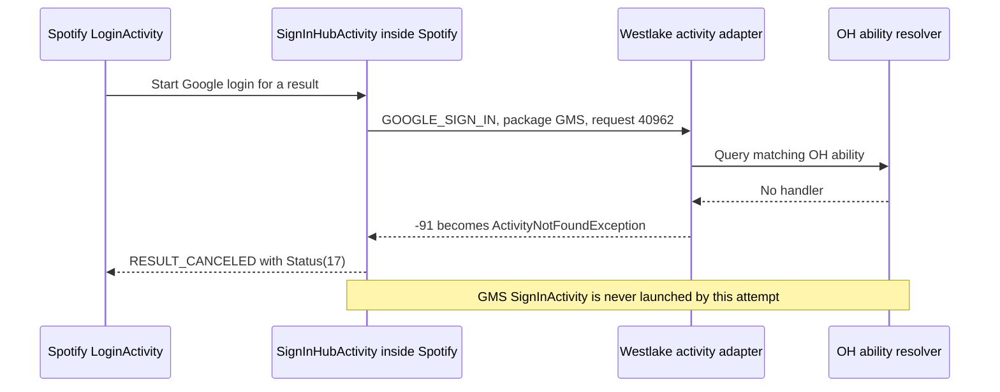

# Spotify Google login: confirmed activity-resolution failure

**Follow-up:** the [activity/result implementation](remote-activity-results.md)
now addresses this diagnosed launch failure and the subsequently observed
nested PendingIntent stall. This page preserves the pre-fix evidence; consult
the follow-up for current validation and remaining limits.

**The immediate failure is local: Westlake cannot resolve the external Google
sign-in activity.** An instrumented board replay on 2026-11-15 Pacific /
2026-11-16 UTC returned Android start error `-91`, followed by Google's
`Status(17)`, and reproduced Spotify's error dialog. The flow fails before the
Google account picker or its authentication stage.

This resolves the uncertainty in the [earlier report](google-official-auth-validation.md).
The independently measured official token-service `BadAuthentication` remains
a separate gap. It is not the cause of this observed Spotify failure.

[Result and artifact pins](../tests/google-auth/spotify-diagnosis/result.json) ·
[Exact diagnostic log](../tests/google-auth/spotify-diagnosis/signin.events.txt) ·
[Error screenshot](../tests/google-auth/spotify-diagnosis/spotify-error.jpeg).

## What the log proves

The fresh Spotify process, PID 32507, emitted these value-free events:

```text
time=1794792477445 external_start action=GOOGLE_SIGN_IN target=com.google.android.gms request_code=40962 oh_handler=false
time=1794792477445 external_start unresolved=true start_result=-91
time=1794792477587 activity_result request_code=2109516255 result_code=0 google_status=17
```

The external launch failed and the error result followed 142 ms later. Request
40962 belongs to the Google SDK hub's call into GMS; request 2109516255 belongs
to Spotify's caller waiting for the hub. They are different nesting levels,
not a mismatched result.

| Layer | Evidence / outcome |
| --- | --- |
| Spotify login button | Starts its bundled `SignInHubActivity` |
| Bundled Google SDK | Requests `com.google.android.gms.auth.GOOGLE_SIGN_IN` in package `com.google.android.gms`, for result 40962 |
| Westlake external activity resolver | `oh_handler=false`; returns `START_INTENT_NOT_RESOLVED` (`-91`) |
| Android `Instrumentation` | Converts that start result to `ActivityNotFoundException` |
| Bundled Google SDK exception handler | Catches that exception, constructs `Status(17)`, sets `RESULT_CANCELED` with `googleSignInStatus`, and finishes |
| Spotify | Receives result code 0 and shows “Something went wrong. Try again.” |

For this `com.google.android.gms.common.api.Status`, Google's documented name
for 17 is `API_NOT_CONNECTED`. The numeric label alone is broad; the launch
events and inspected exception handler identify the actual cause here.
[Google CommonStatusCodes reference](https://developers.google.com/android/reference/com/google/android/gms/common/api/CommonStatusCodes#API_NOT_CONNECTED).



## Why a working GMS service connection does not solve it

The official GMS APK contains the required exported activity:

```text
com.google.android.gms.auth.api.signin.ui.SignInActivity
action: com.google.android.gms.auth.GOOGLE_SIGN_IN
process: com.google.android.gms.ui
exported: true
activity-level permission: none declared
```

The manifest's process resource resolves to `com.google.android.gms.ui`.
That process was already alive, PID 26806. These facts rule out a missing APK
declaration or simply an absent GMS UI process as the immediate explanation.
[Manifest evidence](../tests/google-auth/spotify-diagnosis/gms-manifest-signin.json).

The missing connection is between the Android activity registry and Westlake's
external launch path:

- [`ActivityTaskManagerAdapter.startOutside`](../framework/activity/java/ActivityTaskManagerAdapter.java)
  checks `PackageManagerAdapter.ohHandles(intent)`. For this request it finds
  nothing and returns the fatal start error. It never asks the Play service
  channel to launch GMS's matching Android activity.
- [`PackageManagerAdapter.ohHandles`](../framework/package-manager/java/PackageManagerAdapter.java)
  calls `ohAbilities`, which queries OH BMS. The separate GMS launch/package
  namespace is not thereby published as an OH ability. `queryIntentActivities`
  combines the caller's own registry with OH abilities; it has no corresponding
  remote GMS activity query.
- [`PlayServicesChannel`](../framework/activity/java/PlayServicesChannel.java)
  supports service and provider operations, which explains the working GMS
  binds. Its `startInHome` activity helper addresses an app's own secondary-to-home
  process start without a result. It does not implement Spotify-to-GMS
  `startActivityForResult` and the return path.

The SDK's behavior is verified against the exact signed Spotify APK, not a
generic reconstruction. Its `classes3.dex` `SignInHubActivity.onCreate` has an
`ActivityNotFoundException` handler at code-unit address 148; that handler calls
the method constructing `Status(17)`. The [static inspection record](../tests/google-auth/spotify-diagnosis/spotify-sdk-catch.json)
retains the APK hash and method identity without publishing proprietary
disassembly. AOSP `Instrumentation.checkStartActivityResult` in the local
framework source performs the `-91` to exception conversion.

## What this does and does not say about authentication

This attempt did not reach Google's account picker, account consent, token
exchange or Spotify's authenticated backend. It did not test whether the Google
account already has a Spotify account, and no new account was created.
Changing the test account or manually registering the device would not repair
this local activity-resolution error.

The [auth event audit](../tests/google-auth/spotify-diagnosis/auth-window.events.json)
contains one unrelated Store token request about 24 seconds after the failure;
there are no auth-proxy events between the button action and the error result.
The providers stayed live. That background Store operation must not be counted
as a Spotify authentication request.

The separate SDK/Binder probe still shows that official GMS's token path asks
for credential/cache reads that the token-only proxy withholds. Once the UI
transport is implemented, the real interactive flow must be tested against
that contract too. This diagnosis establishes the first blocker, not successful
login after a hypothetical routing fix or server approval of the hybrid.

## Required implementation

1. Resolve exported Android activities in the target package namespace, with
   intent-filter, enabled-state, permission and verified caller checks. A GMS
   service binding is not an activity-resolution result.
2. Start the selected activity in its declared process through Westlake's
   process/activity management, preserving the original Parcelable Intent and
   caller identity. Do not instantiate GMS's activity in Spotify or convert its
   configuration to lossy JSON.
3. Carry `resultTo`, `resultWho` and `requestCode` across the process boundary,
   then deliver the original result to the SDK hub and onward to Spotify.
   Preserve cancellation, process death, caller destruction and one-time
   completion; a fire-and-forget `NEW_TASK` launch cannot provide this contract.
4. Validate display focus, Back/cancellation and lifecycle with the shared OH
   window management, then separately validate account consent and token
   mediation through the intended providers.

This is reusable Android activity/result adaptation over OH, beyond a Google
token-service hook. A GrapheneOS-style GMS compatibility layer still needs that
underlying OS contract on Westlake.

## Diagnostic change and validation

The replay used the same unmodified Spotify 9.1.86.2432 APK and existing GMS/
Store hosts. Only Spotify received a rebuilt adapter with opt-in diagnostics:

```text
WESTLAKE_GOOGLE_PRIVATE_LOGS=1
WESTLAKE_GOOGLE_SIGNIN_DIAGNOSTICS=1
```

The diagnostic adds no routing fallback or authentication behavior. It records
the fixed action, handler boolean, numeric start result and numeric Google
status. It copies the result Intent and reads only integer field 1 of Google's
Status SafeParcel because R8 removed `getStatusCode()` in this APK. It never
logs status messages, account values, token values or recovery Intent contents.
Both flags are required and it is disabled by default.

Validation passed: 121 adapter sources / 251 classes compiled; runtime packaging,
nine boot JARs / 27 boot artifacts and board framework preload succeeded; the
fresh board run reproduced the error with all three expected diagnostic events.
The base `framework.jar` remained identical to build 04; only the adapter changed.
[Build/source hashes](../tests/google-auth/spotify-diagnosis/build-inputs.json).

Input used the private PID mailbox and the actual SDK/application flow. This
does not establish physical-touch acceptance or production UID/SELinux
isolation; the fixture still shares its native host UID. The requested deep
dive is complete, while the activity/result routing fix remains unimplemented.
